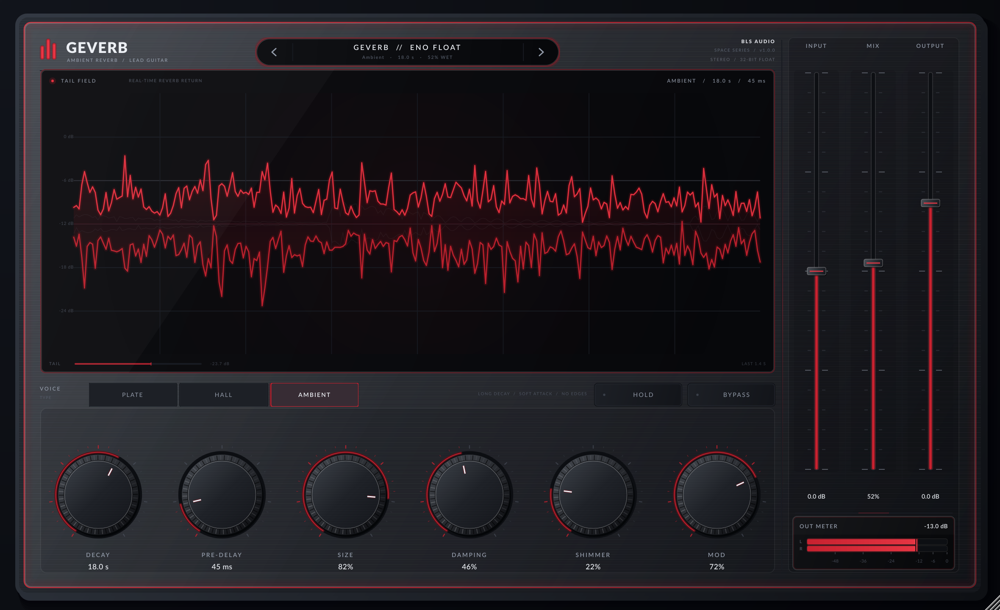

# GEVERB

**Version 1.0.0** · **Lush ambient reverb for lead guitar.** GEVERB is a 64-bit VST3 / Standalone
reverb built around a long, slowly breathing feedback-delay network. It is
voiced for sustained lead lines: soft attacks, dense plate/hall diffusion,
long tails, and an octave-up shimmer bed that lets held notes dissolve into the
room.



## Voice

- **Plate** — close, luminous, quick to bloom.
- **Hall** — wide and dark with a long, even decay.
- **Ambient** — the largest space; dense, soft-edged and made for Eno-style
  floating lines.

The **SHIMMER** control feeds a parallel two-grain octave-up network from the
reverb tail. It has its own filtered feedback loop, so it can rise and sparkle
without destabilising the main decay. **HOLD** mutes new input and lets the
existing tail ring almost indefinitely.

## Controls

| Control | Range | Notes |
| :--- | :--- | :--- |
| Input | -24 to +24 dB | Input trim |
| Mix | 0–100% | Dry/wet blend |
| Output | -24 to +12 dB | Output trim |
| Decay | 0.5–30 s | RT60 of the FDN |
| Pre-Delay | 0–300 ms | Space before the reverb |
| Size | 0–100% | Scales the FDN delay lengths |
| Damping | 0–100% | High-frequency absorption in the tail |
| Shimmer | 0–100% | Octave-up halo level |
| Mod | 0–100% | Slow decorrelated tail movement |
| Voice | Plate / Hall / Ambient | Reverb character |
| Hold | On/Off | Freeze the tail and mute new input |
| Bypass | On/Off | Click-free, sample-accurate bypass |

The three **Input / Mix / Output** sliders live in the full-height mixer bay on
the right edge of the glass panel. A dedicated **OUT METER** sits vertically
below the faders, with horizontal twin L/R ballistic bars, a -60 dB to 0 dB
scale, peak hold, and a live peak dB readout.

## Signal path

```
guitar -> input trim -> pre-delay -> 4-stage diffusion
       -> 8-line Hadamard FDN (damping + slow modulation)
       -> stereo taps -> output high-pass -> dry/wet -> output trim
                              |
                              +-> octave-up shimmer loop -> wet
```

The reverb reports **zero latency**, uses no oversampling, and keeps all
processing allocation-free in `processBlock()`. The waveform display reads a
lock-free decimated ring buffer.

## Factory atmospheres

1. **Eno Float** — ambient / endless drift
2. **Infinite Sky** — ambient / hold the horizon
3. **Cathedral Lead** — hall / wide & dark
4. **Plate Sustain** — plate / close & luminous
5. **Shimmer Veil** — octave halo / slow rise
6. **Slow Bloom** — hall / pre-delayed bloom
7. **Close Lush** — plate / intimate sustain
8. **Lead Into Light** — hall / soft-focus lead

## Build (Linux, offline)

The local build reuses the JUCE 8.0.8 checkout and sysroot in the sibling
`plugin_poc` directory:

```bash
./scripts/setup-linux.sh
./scripts/build.sh
```

Artefacts are copied to `dist/`:

- `dist/Geverb.vst3`
- `dist/Geverb` (Standalone)

## Verification

```bash
./build/GeverbTests_artefacts/Release/GeverbTests
./build/GeverbHostSmokeTest_artefacts/Release/GeverbHostSmokeTest dist/Geverb.vst3
./build/GeverbScreenshot_artefacts/Release/Geverb\ Screenshot --out=dist/geverb-ui.png
```

The DSP tests cover impulse/tail behaviour, RT60 scaling, mode extremes,
freeze, shimmer, dry-path and bypass accuracy, preset/state round-trips, and
waveform telemetry. The host smoke test scans the built VST3, checks the
published parameter set, runs audio through the wrapper, and round-trips state.

## CI

`.github/workflows/build.yml` builds and tests Windows x64, Linux x64, and
macOS Universal (`arm64` + `x86_64`) binaries, packages them, and publishes a
GitHub Release on a version tag or manual dispatch.

## Look

The interface uses the **Sleek Futuristic Studio Hardware** language: brushed
gunmetal, a flush screwless glass overlay with a muted crimson LED edge-glow,
low-profile knurled metal knobs, a full-height right-side mixer bay, and a
central obsidian tail-field display with a glowing crimson waveform.

## License

Plugin source © BLS Audio. Lato is included under the SIL Open Font License
(`Resources/Lato-OFL.txt`).
